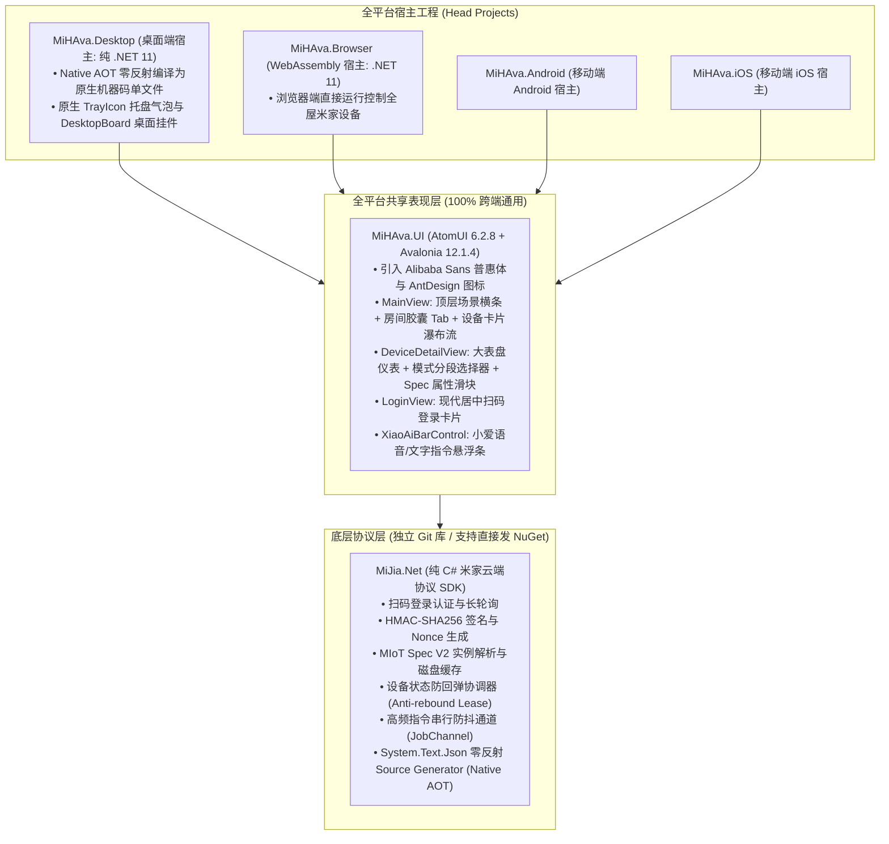

# MiHAva (米家跨平台现代客户端)

<div align="center">


-green.svg)


**基于 Avalonia 12 + AtomUI 深度还原官方米家 App 交互体验的跨平台现代桌面/移动/Web 客户端**

</div>

---

## 📸 官方米家设计还原要点

本项目深度对照米家官方 App 最新设计规范，实现了像素级与交互级的桌面/跨端现代化重构：

| 米家 App 官方元素 | MiHAva 跨平台实现 | 交互特色 |
| :--- | :--- | :--- |
| **家庭下拉与全屋概览** | `CurrentHomeName ▾` + 全屋开启统计 | 实时动态汇总运行设备数与环境温度概览 |
| **全屋快捷场景横条** | `💡 一键关灯` / `🏠 离家模式` / `✨ 回家模式` | 一键并发调度指定分组设备，防抖下发 |
| **横向吸顶房间 Tab** | 现代化圆角胶囊横向平铺 (`roomTabs`) | 支持平滑滚动，带各房间设备数微标 |
| **米家经典大圆钮卡片** | 左上品类图标 + 右上大号电源圆钮 + 底部状态文案 | 开机显示米家绿高亮发光，关机为微灰低调底色 |
| **设备详情大仪表盘** | 顶部大号 Hero 表盘（PM2.5 / 温度 / 功率数码屏） | 伴随优良中差光环与运行状态徽章 |
| **横向大分段模式选择** | `[ 自动 ]  [ 睡眠 ]  [ 最爱 ]  [ 强力 ]` | 选态米家绿高亮，未选态柔和灰底 |
| **小爱语音/文字指令栏** | 紧凑胶囊输入条 + 音箱选择下拉框 | 在 PC/浏览器/手机上直接给家里小爱下达自然语言指令 |
| **桌面置顶浮动挂件** | `DesktopBoardWindow` 无边框亚克力浮窗 | 支持鼠标任意拖拽、置顶常驻桌面快速开关 |
| **系统托盘快捷控制** | `TrayControlWindow` 任务栏贴边气泡窗口 | 失焦自动隐藏，无需打开完整主窗口即可操作 |

---

## 🏗️ 整体系统架构与工程划分



---

## 📁 目录组织

```
MiHAva /
├── src/
│   ├── MiJia.Net/               # [核心 SDK 库] 独立 Git 仓库，可单独推送发布到 NuGet.org
│   │   ├── Auth/                # 扫码登录与 Token 自动续期
│   │   ├── Cloud/               # 米家云端 API 交互客户端 (签名/请求/解密)
│   │   ├── Models/              # 数据传输对象 (设备/家庭/属性/动作)
│   │   ├── Security/            # Nonce 与 HMAC-SHA256 签名核心
│   │   ├── Serialization/       # MiJiaJsonContext 静态 AOT 零反射源生成器
│   │   ├── Spec/                # MIoT Spec 实例拉取与二级磁盘缓存
│   │   ├── State/               # 租约防回弹协调器与并发防抖 Channel
│   │   └── XiaoAi/              # 小爱音箱自然语言指令与 TTS
│   │
│   ├── MiHAva.UI/               # [共享 UI 层] 基于 AtomUI，全端通用
│   │   ├── Controls/            # DeviceCardView (米家经典卡片), SpecPropertyControl, XiaoAiBarControl
│   │   ├── Views/               # MainView (主工作台), LoginView (扫码登录), DeviceDetailView (详情表盘)
│   │   ├── ViewModels/          # MainViewModel, DeviceCardViewModel, DeviceDetailViewModel 等
│   │   └── Converters/          # 强类型绑定转换器
│   │
│   ├── MiHAva.Desktop/          # [桌面宿主: .NET 11] 纯原生 AOT 单文件、托盘气泡、桌面置顶挂件
│   ├── MiHAva.Browser/          # [WebAssembly 宿主: .NET 11] 浏览器直连运行
│   ├── MiHAva.Android/          # [Android 宿主] 移动端 SingleView
│   ├── MiHAva.iOS/              # [iOS 宿主] 移动端 SingleView
│   └── MiJia.Net.CLI/           # [CLI 自检工具] 终端扫码登录与设备/属性拉取测试
│
├── tests/
│   └── MiJia.Net.Tests/         # 单元测试 (签名/防回弹/Spec/防抖测试，8/8 通过)
│
└── MiHAva.slnx                  # 统一跨平台解决方案
```

---

## 🚀 编译与运行

### 1. 桌面端 (.NET 11)

```bash
# 本地调试运行
dotnet run --project src/MiHAva.Desktop/MiHAva.Desktop.csproj

# 发布为原生单文件独立程序 (Native AOT，启动 <50ms，零依赖)
dotnet publish src/MiHAva.Desktop/MiHAva.Desktop.csproj -c Release
# 产物位于: src/MiHAva.Desktop/bin/Release/net11.0/[os-arch]/publish/MiHAva.Desktop
```

### 2. 浏览器端 (WebAssembly)

```bash
dotnet run --project src/MiHAva.Browser/MiHAva.Browser.csproj
# 浏览器访问 http://localhost:5000 即可运行
```

### 3. 运行自动化单元测试

```bash
dotnet test
```

---

## 📦 `MiJia.Net` 独立 NuGet 发布指南

`src/MiJia.Net` 拥有完全独立的 Git 仓库与标准包配置，可直接作为开源 NuGet 包分发给全世界的 .NET 开发者使用：

```bash
# 1. 进入独立库目录
cd src/MiJia.Net

# 2. 执行编译并打包 Release
dotnet pack -c Release

# 3. 推送到 NuGet.org (请替换 YOUR_NUGET_API_KEY)
dotnet nuget push bin/Release/MiJia.Net.1.0.0.nupkg \
  --api-key YOUR_NUGET_API_KEY \
  --source https://api.nuget.org/v3/index.json
```

---

## 📄 开源许可证

本项目遵循 [MIT 许可证](src/MiJia.Net/LICENSE)。
